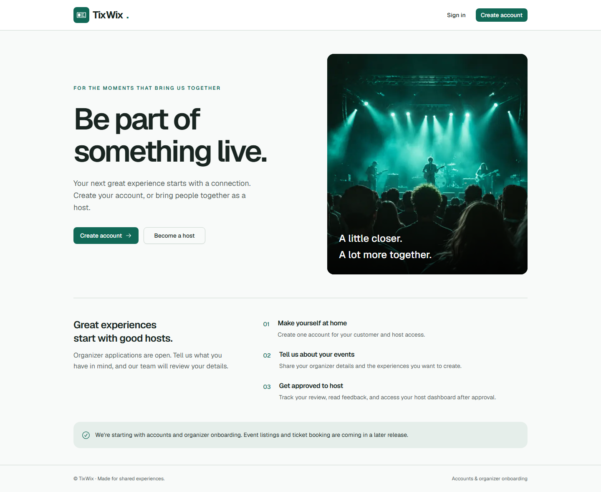
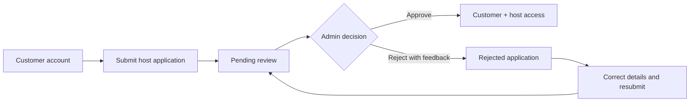

# TixWix

**CSE470 Software Engineering Project · Sprint 1, Division 1**

An event platform being developed in stages. This milestone delivers the complete **customer account → host application → administrator review → approved-host access** workflow using a live Supabase backend.

[](https://github.com/rifatpriyo/tixwix-470/actions/workflows/ci.yml)

[Features](#implemented-features) · [Architecture](#architecture) · [Run locally](#run-locally) · [Verification](#verification) · [Demonstration](#faculty-demonstration) · [Documentation](#documentation)



_Actual application screenshot captured locally. The concert image is decorative; event listings and ticket booking belong to later milestones._

## Current milestone

**Status as of 5 November 2026:** Division 1 is implemented and verified against the hosted development Supabase project. Registration, sign-in, persistent sessions, and the application-to-approval workflow work with real Auth and database services. The database migration is applied, and Row Level Security is enabled on all five application tables.

The implementation is published on `main` and `feature/sprint-1-division-1`. Public hosting is pending; this repository does not yet have a deployed demo URL. Local registration currently signs users in immediately because email confirmation is disabled for development.

## Implemented features

| Area                       | Completed behavior                                                                                                                            |
| -------------------------- | --------------------------------------------------------------------------------------------------------------------------------------------- |
| Accounts                   | Email/password registration, sign-in, sign-out, persistent sessions, and signup confirmation callback handlers                                |
| Role-based access          | Customer, host, and administrator permissions validated on the server using protected database roles                                          |
| Host applications          | Organizer details, pending/approved/rejected status, duplicate submission protection, and application history                                 |
| Rejection and resubmission | Required rejection feedback; corrected details create a new submission while preserving previous records                                      |
| Administrator review       | Status filtering, pagination, application details, review history, approval, and rejection                                                    |
| Host approval              | One database transaction records the decision, creates the host profile, and grants host access; the original customer account remains active |
| Interface                  | Responsive landing page, authentication forms, customer dashboard, application page, host dashboard, and administrator review screens         |
| Engineering deliverables   | SQL migration, guarded admin bootstrap, reusable JSON APIs, automated tests, GitHub Actions workflow, and technical documentation             |

### Application workflow



Approval takes effect on the next request without creating another account. Resubmission preserves previous applications and review feedback. Repeating an identical review decision does not duplicate the review or host role.

## Architecture

The project uses an MVC-style separation of presentation, request handling, business workflows, and persistence.

| Layer          | Technology and location                                                                             |
| -------------- | --------------------------------------------------------------------------------------------------- |
| Views          | Next.js 16 App Router, React 19, TypeScript — `src/app` and `src/components`                        |
| Styling        | Tailwind CSS 4, shadcn/ui, Radix UI, and locally hosted Geist fonts                                 |
| Controllers    | Node.js Route Handlers and validated JSON request boundaries — `src/controllers`                    |
| Services       | Authentication, authorization, application submission, and review workflows — `src/services`        |
| Repositories   | Typed database queries and RPC calls — `src/repositories`                                           |
| Persistence    | Supabase PostgreSQL, constraints, RLS policies, and transactional functions — `supabase/migrations` |
| Authentication | Supabase Auth with server-managed cookie sessions and verified user identity                        |
| Testing        | Vitest, PGlite PostgreSQL, Playwright, and opt-in hosted Supabase integration tests                 |

**Access control is enforced beyond the UI.** The server validates identity and reads roles from the protected `user_roles` table. Client-submitted IDs, roles, and editable Auth metadata cannot grant permissions. RLS restricts record access, while database transactions protect approval and resubmission rules. The application uses a publishable key and the caller's identity; it does not require a service-role key.

See the [architecture and MVC mapping](docs/architecture.md) and [JSON API contract](docs/api.md) for implementation details.

## Run locally

Use **Node 22.23.4** from [`.nvmrc`](.nvmrc), or supported **Node 24 LTS**, and npm.

1. Clone the repository and install dependencies:

   ```powershell
   git clone https://github.com/rifatpriyo/tixwix-470.git
   cd tixwix-470
   npm ci
   ```

2. Create local configuration without overwriting an existing file:

   ```powershell
   if (-not (Test-Path .env.local)) { Copy-Item .env.example .env.local }
   ```

   Fill these values in `.env.local`:

   ```dotenv
   NEXT_PUBLIC_SUPABASE_URL=https://YOUR_PROJECT_REF.supabase.co
   NEXT_PUBLIC_SUPABASE_PUBLISHABLE_KEY=YOUR_PUBLISHABLE_KEY
   APP_URL=http://127.0.0.1:3000
   ```

   `.env.local` is excluded from Git. Use a publishable key here; secret and service-role keys do not belong in application configuration.

3. Use the already configured development project, or follow the [Supabase setup guide](docs/setup.md#supabase-setup) for a fresh project. The current development database already has migration `202611040001`; do not reapply its creation SQL.

4. Start the application:

   ```powershell
   npm run dev
   ```

   Open **[http://127.0.0.1:3000](http://127.0.0.1:3000)**. Use the same origin as `APP_URL`.

Administrator access requires the [verified-account bootstrap procedure](docs/setup.md#bootstrap-an-administrator). There are no default admin credentials or public admin-registration controls.

## Verification

The latest recorded implementation verification completed **43 tests** across four suites, plus lint, TypeScript checking, and a production build. These are recorded results from the connected implementation run; live suites are opt-in and are not part of every CI run.

| Suite / check                          | Recorded result | Coverage                                                                                                        |
| -------------------------------------- | --------------- | --------------------------------------------------------------------------------------------------------------- |
| Unit + embedded PostgreSQL             | **29 passed**   | Validation, controllers, mocked Auth behavior, and migration/RLS/transaction checks on PGlite                   |
| Hosted Supabase integration            | **3 passed**    | Real Auth sessions, PostgREST, concurrent submissions/reviews, protected writes, and ownership policies         |
| Desktop/mobile browser smoke tests     | **10 passed**   | Public screens, responsive layout, navigation, and denied-access paths                                          |
| Live browser workflow                  | **1 passed**    | Actual registration, login/logout, session persistence, application submission, admin approval, and host access |
| ESLint / TypeScript / production build | **Passed**      | Source checks, strict types, and Next.js compilation                                                            |

Run the standard checks from the repository root:

```powershell
npm run lint
npm run typecheck
npm test
npm run build
npx playwright install chromium
npm run test:e2e
```

Stop any existing local server on port 3000 before browser tests; Playwright starts its own production server. [GitHub Actions](.github/workflows/ci.yml) runs the standard checks above.

The separate `npm run test:integration` and `npm run test:e2e:live` commands require explicit opt-in and test configuration. Disabled suites are **skipped**, not passed; enabling the live browser suite without its credentials fails setup. They create temporary accounts in a development/test project and remove them afterward. Follow the [test setup and safety requirements](docs/setup.md#verify).

The [verification report](docs/sprint-1-division-1.md#verification-evidence) records the test boundaries, executed commands, and dependency audit results. Mocked Auth tests and embedded PostgreSQL tests are distinguished from actual Supabase integration tests.

## Faculty demonstration

Prepare a customer account and a separate administrator account using the [bootstrap guide](docs/setup.md#bootstrap-an-administrator). Use separate browser profiles for the two roles.

1. **Account lifecycle:** register, reach the customer dashboard, reload to demonstrate session persistence, then sign out and sign back in.
2. **Application submission:** enter organizer details at `/dashboard/host-application` and show the pending state.
3. **Feedback:** as admin, open `/admin/host-applications`, inspect the submission, and reject it with feedback.
4. **Revision history:** as the customer, read the feedback, correct the details, and resubmit. Show that the previous submission remains available.
5. **Approval:** as admin, approve the new submission. Refresh the customer's dashboard and open `/host` using the same account.
6. **Authorization:** show that an ordinary customer cannot access administrator or host-only operations.

For the full acceptance checklist, including duplicate-decision and database access checks, see the [connected acceptance flow](docs/setup.md#connected-acceptance-flow).

## Scope and remaining work

This release covers **Sprint 1, Division 1 only**, including the **host-verification portion of SRS F17**. Event moderation, event creation and discovery, ticket booking, payments, and Flutter screens remain outside this milestone.

Before a public demonstration deployment:

- Bootstrap the intended permanent administrator using a verified account UUID.
- Configure SMTP, enable email confirmation, and verify delivery with a real mailbox. Callback handlers are implemented, but live email delivery and the confirmation-enabled signup flow remain unverified.
- Configure and verify a Vercel preview deployment. The application currently runs locally against hosted Supabase.

## Documentation

| Document                                                  | Purpose                                                                                                |
| --------------------------------------------------------- | ------------------------------------------------------------------------------------------------------ |
| [Setup and verification guide](docs/setup.md)             | Local configuration, Supabase migration, auth settings, admin bootstrap, tests, and preview deployment |
| [Architecture and MVC mapping](docs/architecture.md)      | Layer responsibilities, authorization, database design, and transactional behavior                     |
| [JSON API contract](docs/api.md)                          | Routes, permissions, payloads, validation, and error responses                                         |
| [Division 1 progress report](docs/sprint-1-division-1.md) | Completed work, verification evidence, limitations, and remaining setup                                |
| [Visual asset provenance](docs/assets.md)                 | Source of the landing-page imagery, fonts, icons, and README screenshot                                |

**Maintainer:** [Rifat Sadeq Priyo](https://github.com/rifatpriyo) · **Course:** CSE470 · **Milestone:** Sprint 1, Division 1
